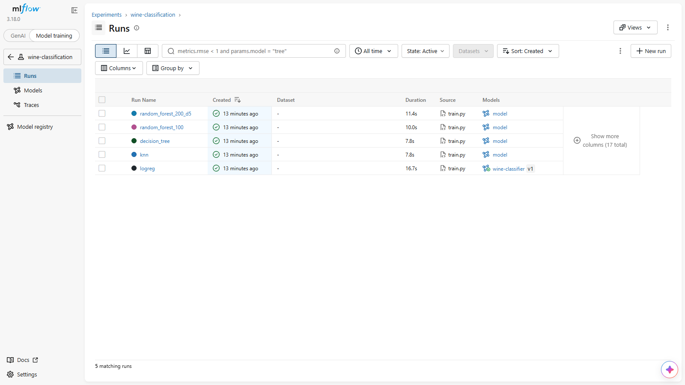
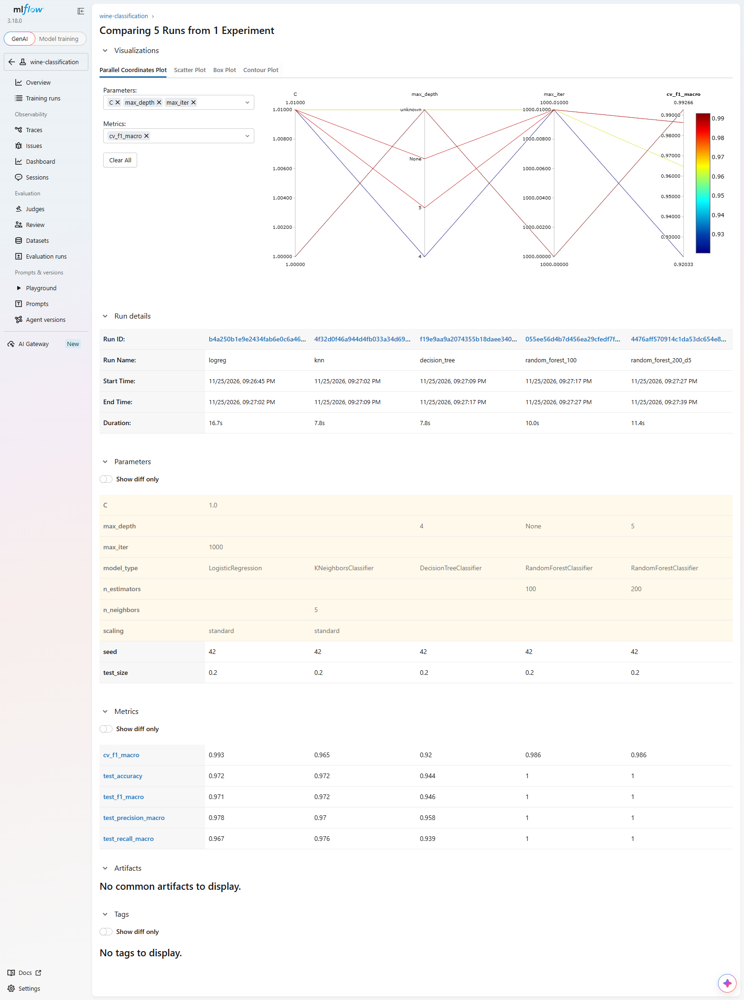
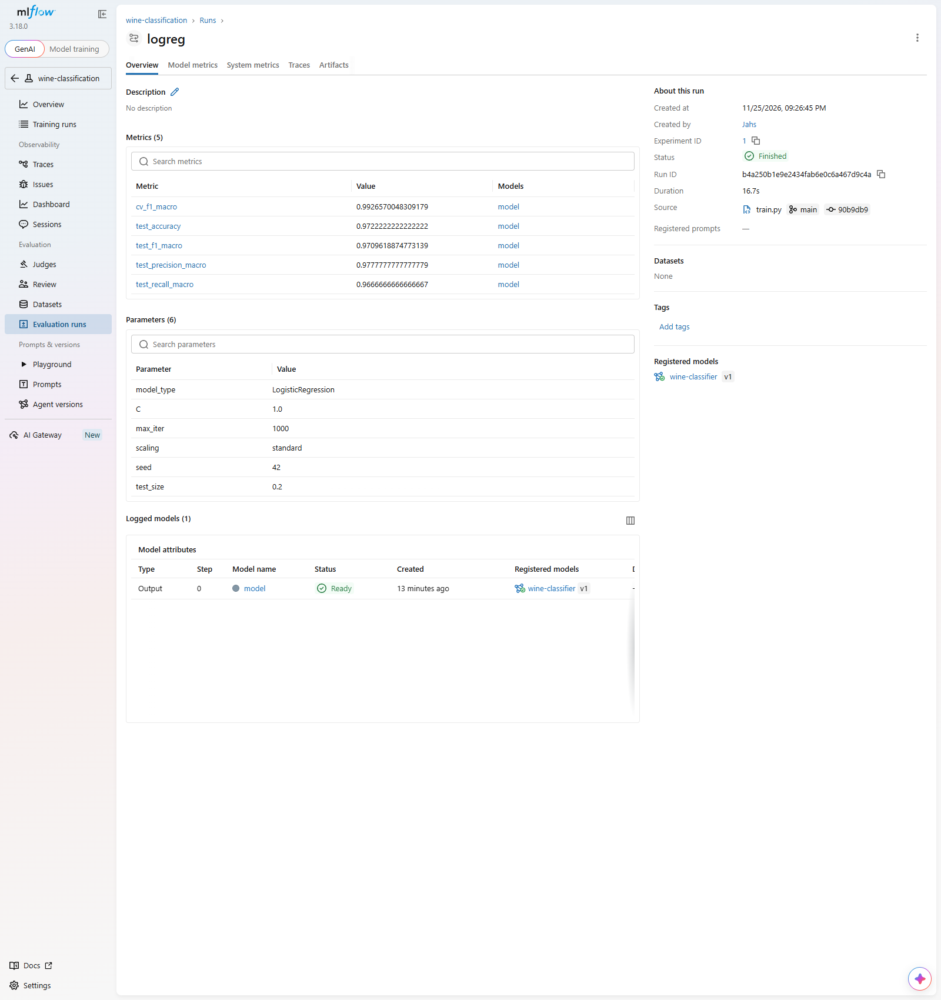
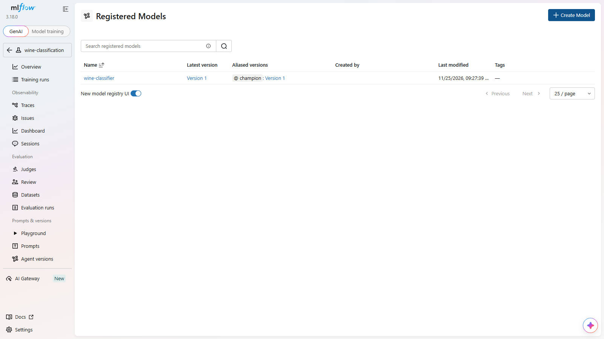
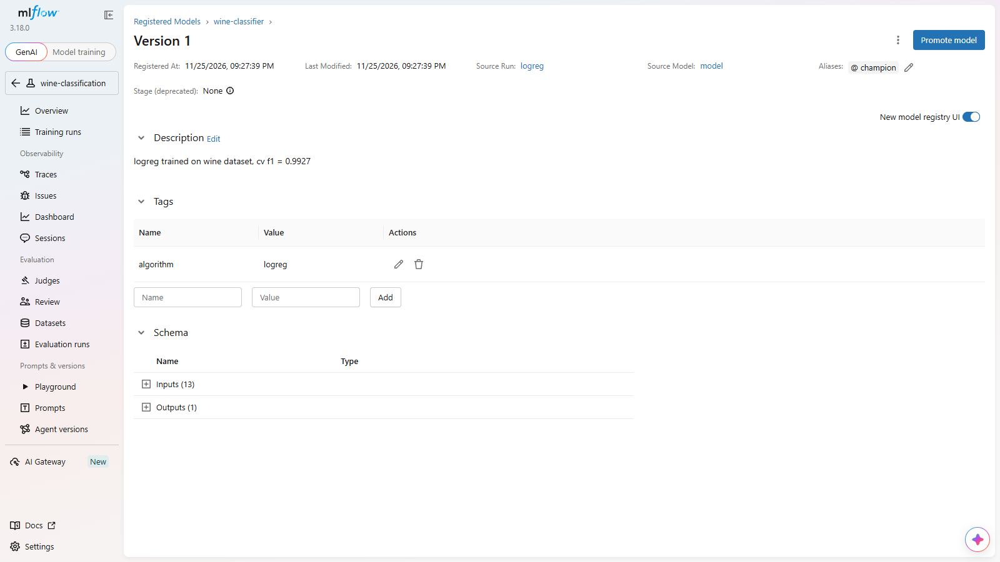
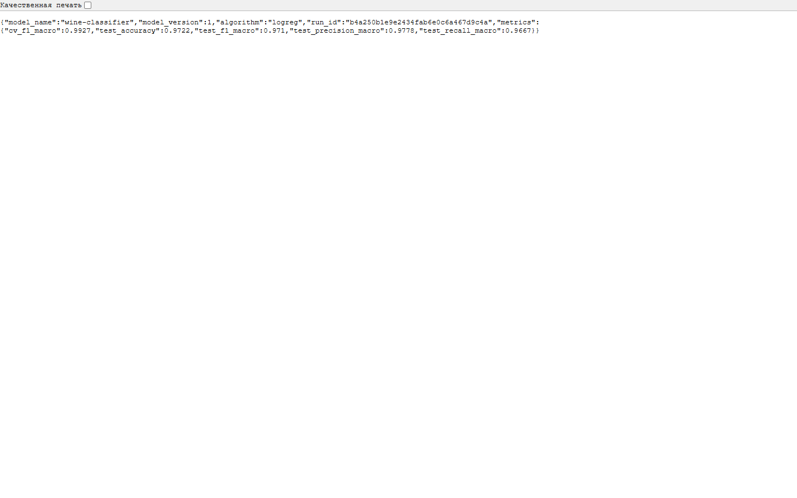
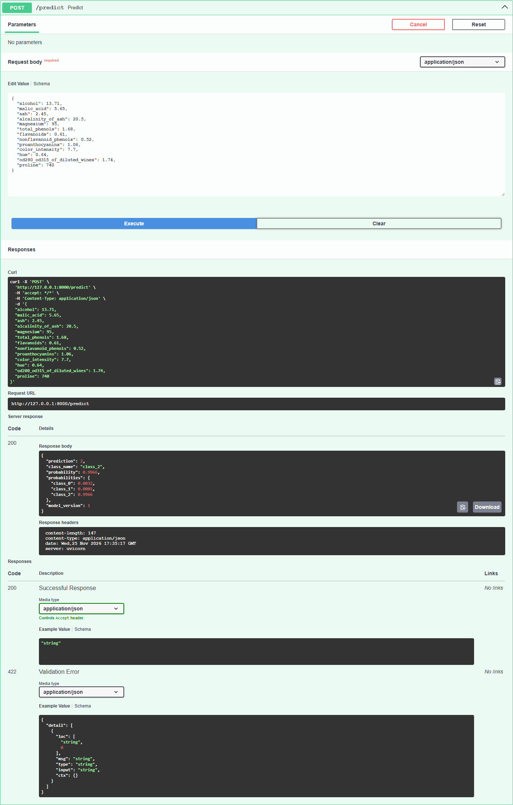
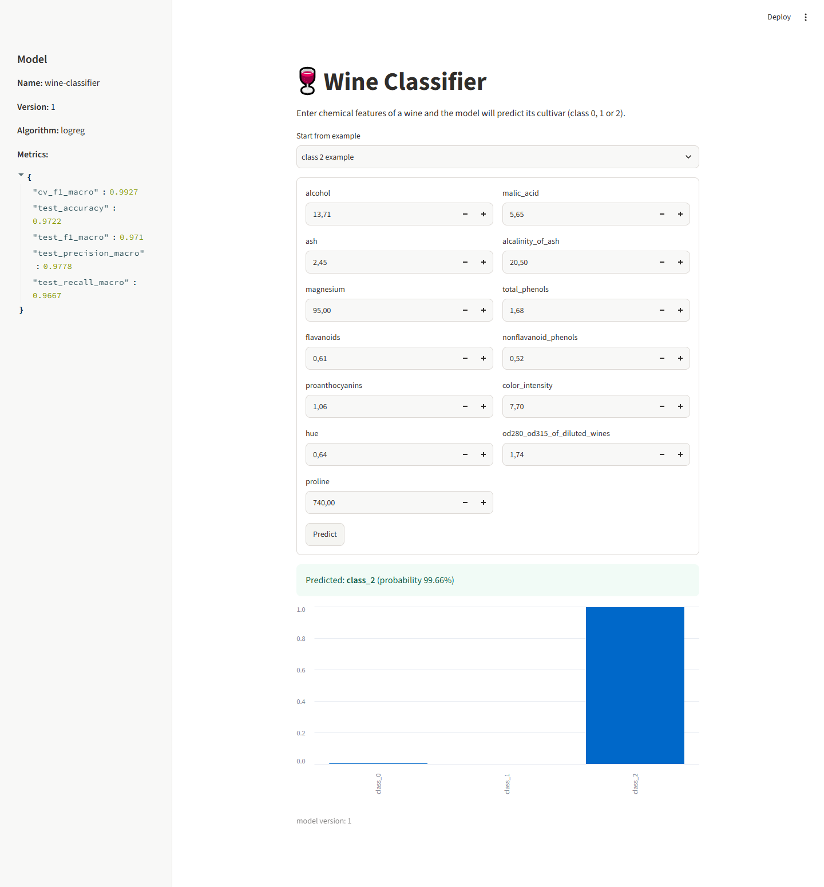
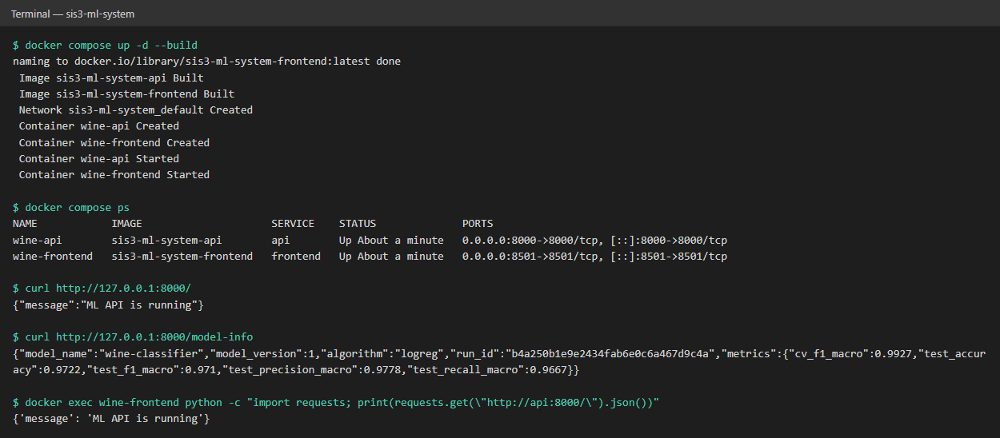

# SIS 3 — ML System: FastAPI + Docker + Streamlit + MLflow

**Student:** Abdimutalipov Zhaxylyk, 23B031056

This is continuation of Practical Task 6 (repo: https://github.com/zhaqsylyqq/pw6-ml-fastapi-docker). There we trained a model, served it with FastAPI and put it into Docker.
Here we extend it to a more complete ML system:

- **MLflow** — experiment tracking (params, metrics, model artifacts) + Model Registry (name + version)
- **Streamlit** — simple frontend where user enters features and gets prediction
- **docker-compose** — runs API and frontend together

## Architecture

```
 train.py ──logs runs──► MLflow (experiment "wine-classification")
    │                        └─ Model Registry: "wine-classifier" v1 (alias @champion)
    │
    └─ saves best model ──► api/model.joblib + api/model_info.json
                                   │
 Streamlit (8501) ──HTTP──► FastAPI (8000) ── /predict, /model-info
```

## Dataset

Wine dataset (UCI, built into scikit-learn): 178 wines, 13 chemical features, 3 classes (3 grape cultivars).
Split 80/20 stratified, SEED = 42.

## Project structure

```
sis3-ml-system/
├── train.py               # trains 5 models, logs to mlflow, registers best
├── load_from_registry.py  # loads model from registry and predicts
├── requirements.txt       # training deps (mlflow, sklearn)
├── docker-compose.yml     # api + frontend
├── api/
│   ├── main.py            # fastapi app
│   ├── model.joblib       # best model (created by train.py)
│   ├── model_info.json    # model name, version, metrics
│   ├── requirements.txt
│   └── Dockerfile
└── frontend/
    ├── app.py             # streamlit app
    ├── requirements.txt
    └── Dockerfile
```

## MLflow integration

### Experiment tracking

Experiment name: `wine-classification`. We trained 5 models, each one is a separate run. For every run we log:

- **parameters** — model type and hyperparameters (C, n_neighbors, max_depth, n_estimators), seed, test_size
- **metrics** — 5-fold CV F1 macro on train, test accuracy, F1 macro, precision macro, recall macro
- **artifacts** — model in mlflow format (with signature and input example) + `model.joblib` file

Results:

| run | CV F1 macro | test accuracy | test F1 macro |
|---|---|---|---|
| logreg (C=1.0, scaled) | **0.9927** | 0.9722 | 0.9710 |
| knn (k=5, scaled) | 0.9648 | 0.9722 | 0.9718 |
| decision_tree (max_depth=4) | 0.9203 | 0.9444 | 0.9457 |
| random_forest_100 | 0.9863 | 1.0000 | 1.0000 |
| random_forest_200_d5 | 0.9863 | 1.0000 | 1.0000 |

As we see random forest has 1.0 on test, but test set is only 36 rows, so its not reliable to choose by it.
Thats why we choose best model by **CV F1 on train** (5 folds, more stable) and use test only as a check.
By CV the best is logistic regression (0.9927), random forest is close (0.9863), single decision tree is the worst (0.9203) because of high variance.

### Model Registry

Best model is registered automatically by `train.py`:

- **name:** `wine-classifier`
- **version:** 1 (every new run of `train.py` creates next version: 2, 3, ...)
- **alias:** `champion` → points to the latest best version
- **tag:** `algorithm = logreg`, plus description with CV score

Model can be loaded from registry by name/version or alias:

```python
mlflow.sklearn.load_model("models:/wine-classifier/1")
mlflow.sklearn.load_model("models:/wine-classifier@champion")
```

(see `load_from_registry.py`)

## How to run

### 1. Train + MLflow

```bash
pip install -r requirements.txt
python train.py
```

Open MLflow UI:

```bash
mlflow ui --backend-store-uri sqlite:///mlflow.db --port 5000
```

Then go to http://127.0.0.1:5000 → **Experiments → wine-classification** (runs, params, metrics, artifacts) and **Models → wine-classifier** (versions).

Check registry loading:

```bash
python load_from_registry.py
```

### 2. Run API + frontend with Docker

```bash
docker compose up --build
```

- API: http://127.0.0.1:8000 → `{"message": "ML API is running"}`
- Swagger: http://127.0.0.1:8000/docs
- Model info: http://127.0.0.1:8000/model-info
- Streamlit: http://127.0.0.1:8501

Stop: `docker compose down`

### 3. Run without Docker (optional)

```bash
cd api && pip install -r requirements.txt && uvicorn main:app --reload
# new terminal
cd frontend && pip install -r requirements.txt && streamlit run app.py
```

## API endpoints

| method | endpoint | description |
|---|---|---|
| GET | `/` | health message |
| GET | `/model-info` | registered model name, version, algorithm, metrics |
| POST | `/predict` | 13 features → class, probability, probabilities of all classes |

Example response of `/predict`:

```json
{
  "prediction": 2,
  "class_name": "class_2",
  "probability": 0.9966,
  "probabilities": {"class_0": 0.0032, "class_1": 0.0001, "class_2": 0.9966},
  "model_version": 1
}
```

## Conclusion

- From PW6 we moved from one model + API to a full pipeline: **train → track → register → serve → UI**
- MLflow gives us opportunity to compare all runs in one place and not lose which params gave which metrics
- Model Registry keeps versions, so we always know which model version is in API (it is shown in Streamlit sidebar and in `/model-info`)
- **Best model: logistic regression, CV F1 = 0.9927, registered as wine-classifier v1**

## Screenshots

**MLflow — runs of experiment `wine-classification`**



**MLflow — comparing all 5 runs (params + metrics)**



**MLflow — best run (logreg): metrics, params, registered model**



**MLflow Model Registry — `wine-classifier` with alias `@champion`**





**FastAPI — `/model-info` and `/predict`**





**Streamlit frontend** (running in docker compose, talks to API by `http://api:8000`)



**docker compose** — API and frontend containers are running together


